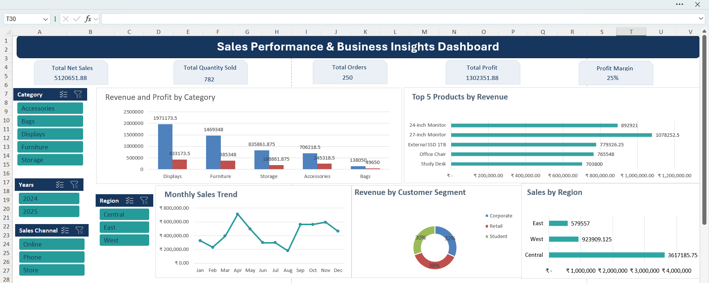

# Excel Sales Analysis Project

## Project Overview
This project focuses on analyzing sales data using Microsoft Excel to understand business performance, customer behavior, product performance, and profitability.

The project transforms cleaned sales data into meaningful business insights through data analysis and an interactive dashboard.

## Dashboard Preview

## Tools and Techniques Used
- Microsoft Excel
- VLOOKUP and Excel formulas
- Calculated columns
- PivotTables and PivotCharts
- Slicers
- Interactive Dashboard

## Data Preparation
Prepared and organized the Orders, Products, and Customers datasets. Created calculated columns to determine:

- Gross Sales
- Discount Amount
- Net Sales
- Total Cost
- Profit

## Analysis Performed
- Sales and profit analysis by product category
- Regional sales performance
- Monthly sales trends
- Revenue analysis by customer segment
- Top 5 products by revenue

## Key Performance Indicators (KPIs)
- Total Net Sales
- Total Quantity Sold
- Total Orders
- Total Profit
- Profit Margin

## Workbook Structure

| Worksheet | Description |
|---|---|
| Project Overview | Project introduction and objectives |
| Dashboard_Sheet | Interactive sales dashboard |
| Sales_Analysis | Sales analysis |
| Orders_working_sheet | Cleaned orders data |
| Products_working_sheet | Cleaned products data |
| Customer_working_sheet | Cleaned customer data |

## Project Objective
To develop practical Excel data analysis skills and transform raw business data into meaningful insights that support data-driven decision-making.

## Project Files
The Excel workbook is available in this repository:

`Excel_Sales_Analysis_Portfolio.xlsx`
